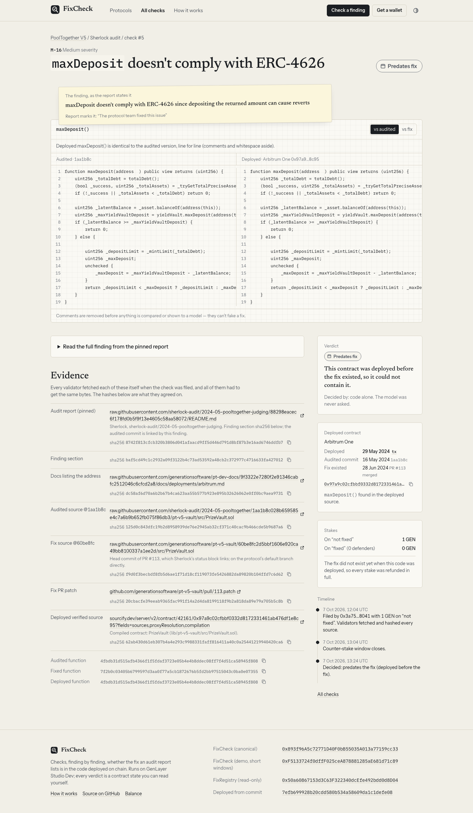

# FixCheck

**The audit says it was fixed. Is the fix in the deployed code?**

Live: **https://fixcheck-ledger.vercel.app** · GenLayer Studio Dev · contracts in [`contracts/`](contracts/) · v2 milestone: [`docs/MILESTONE.md`](docs/MILESTONE.md)

## The problem

Public audit reports (Sherlock, Code4rena, Cantina…) end with a list of findings and a status: *Fixed*. Users read "audited, all fixed" and trust the protocol. Nobody checks whether the code that is actually deployed on chain contains each fix. Sometimes it doesn't: the fix was merged in the repository but the deployed contract was never replaced, the contract was deployed before the audit and can't be upgraded, or it was deployed before the fix even existed. And a fix that is deployed can be undone by a later upgrade.

FixCheck checks it, using the real report, the real commits and the verified code running at the protocol's own listed address — one finding at a time, or a **whole report** at once — and keeps watching every fixed proxy for upgrades.

## New in v2

| | What | Where |
|---|---|---|
| 1 | **Whole-report scorecards.** Given a pinned report, code enumerates *every* finding and the auditor's own status for it (fixed / acknowledged / not mitigated / none). Each finding marked fixed is a slot; nobody picks a subset. A report that can't be enumerated completely is refused whole. After the filing window every slot nobody checked is counted **NOT_CHECKED**. | [`/scorecards`](https://fixcheck-ledger.vercel.app/scorecards) |
| 2 | **Code4rena** as a second auditor, read only from its own mitigation review (pinned `report.md` in the contest's `code-423n4/*-findings` repo, with the same branch proof). Cantina and Spearbit are not added: see Known limitations. | [`/import`](https://fixcheck-ledger.vercel.app/import) |
| 3 | **Regression watch.** A patrol bot on a 30-minute GitHub Actions schedule watches every proxy whose latest verdict is FIXED; on an upgrade it re-files the check against the new implementation. The audited function deployed again is **REGRESSED** (decided by code; pays like NOT_FIXED). The bot decides or expires its own filings and closes scorecards after their deadlines. | [`/regressions`](https://fixcheck-ledger.vercel.app/regressions), [`tools/patrol.mjs`](tools/patrol.mjs), [`.github/workflows/patrol.yml`](.github/workflows/patrol.yml) |
| 4 | **FixStatus** consumer: `is_fixed(finding_id, chain, address)`, `status(...)`, `protocol_score(protocol)`; **FixGate**, a demo contract that refuses to interact with a deployment whose finding is NOT_FIXED or REGRESSED. | [`/status`](https://fixcheck-ledger.vercel.app/status) |
| 5 | **Frontend v2**: scorecard pages, regression timeline, import-a-report flow, FixStatus checker; every transaction shown submitted → accepted → confirmed by re-reading contract state → finalized. | the site |
| 6 | **Public API + badge**, read from chain on every request: `/api/fixcheck?finding=…&chain=…&address=…`, `/badge/<protocol>.svg`. | [API](https://fixcheck-ledger.vercel.app/status#api) |
| 7 | **Exact counts per auditor and per protocol**, each a counter the contract stores. | [`/auditors`](https://fixcheck-ledger.vercel.app/auditors) |

## What it found

<!-- RESULTS:BEGIN -->
On the canonical contract (read from chain by `tools/seeds_md.mjs`): **28 checks**, **3 whole-report scorecards** (PoolTogether V5 · Sherlock: 22 findings, 14 marked fixed, 10 checked, 3 confirmed fixed, 1 not fixed, 4 not checked; PoolTogether V5 · Code4rena: 36 findings, 27 marked fixed, 5 checked, 3 confirmed fixed, 0 not fixed, 22 not checked; Mellow Flexible Vaults · Sherlock: 15 findings, 13 marked fixed, 8 checked, 5 confirmed fixed, 0 not fixed, 5 not checked).

* **Fixed in deployed code** — 11 checks: the deployed function is the fix's, or holds the fix in place (incl. Code4rena findings and a real Mellow proxy, now watched for upgrades).
* **Not fixed** — 1: the deployed function is still the audited version on code deployed *after the fix existed* (PoolTogether's Ethereum vault, created 2024-08-19; its fix was merged on 2024-06-28).
* **Predates audit** — 6; **Predates fix** — 1: the audited code runs on contracts deployed before the audit (or before the fix existed) and not upgradeable, so the fix could not be there. FixCheck says so instead of calling them "not fixed".
* **Inconclusive** — 9: code could not prove which function runs (partially verified source) or the model's answers did not point at the fix. Everyone is refunded.
* **Regressed** — 0: no watched proxy has been upgraded back to the audited code.
* **Not checked** — every finding a report marks fixed that nobody filed a check for, counted per scorecard.

The 22 checks of v1 were re-run on v2: 22 of 22 unchanged ([before/after](docs/SEEDS.md#the-22-v1-checks-re-run-on-v2-before--after)).
<!-- RESULTS:END -->

These are code facts, not claims about exploitability or anyone's intent.

## How it works

1. **File.** A challenger stakes GEN on *not fixed* and names: a **pinned audit report** — Sherlock (a `sherlock-audit/*-judging` repo on GitHub raw at a commit SHA, or a web.archive.org capture of one or of `audits.sherlock.xyz`) or Code4rena (`report.md` in a `code-423n4/*-findings` repo at a commit SHA), the finding id, the function, the audited source file at its commit, the **fix commit's** file (required), the chain, the deployed address, and a **pinned** docs page of the protocol that lists that address.
2. **Validators read everything themselves** and must agree on every field and on the sha256 of every immutable body. Code checks, before anything is stored:
   * every link is pinned and spelled one way (no `%`-escapes); an archived capture must be dated no later than the filing, and the capture served must be exactly that one (its `Memento-Datetime`);
   * the report's and the docs' pinned GitHub commits are on a **branch of the repository each URL names** (not only in a fork, a pull request or a tag; a renamed repo must be named as it is now); the branch is stored as proof;
   * the finding heads a section of the report and names the function, and the **auditor's own status** marks it fixed: for Sherlock, its status block — on **GitHub's issue page** for that finding, written by a `sherlock-admin*` account and linking this fix; for Code4rena, its **mitigation review** — the finding's `**Status**:` line and its rows in every *Mitigation Review Summary* and *Individual PRs* table must agree (`Mitigation confirmed`), and the fix PR is read from that row;
   * the audited file is the finding's own audited commit (a code link in the finding's section, or in the same report); the fix file is the head of the PR — or a commit — that the auditor's status links. Comments by anyone else are never read for the fix;
   * the fix is in the protocol's own GitHub account (the owner of its pinned docs) and on its **default branch**, directly or through the PR's merge commit; the fix commit's date and the PR's merge date are recorded;
   * the docs page lists the address, and the contract has a **full/exact** verified-source match;
   * a proxy is resolved through its EIP-1967 slot, read at a block the leader names and every validator re-reads (it must still hold the current implementation, with no `Upgraded` event above it), cross-checked with the explorer; only the implementation's code is judged; a beacon proxy is inconclusive;
   * every chain fact — slots, the creation block's time and code, the switch's `Upgraded` event and time — is read from **two RPCs run by different operators** and must agree exactly; a creation date counts only if that block created the code that runs now;
   * the function belongs to the contract the explorer says was **compiled** at that address, or to one of its parents (resolved through import aliases); nothing in that chain overrides it, nor a function or modifier it — or the fix — calls;
   * the audited commit's date, the creation time of the deployment (and of its implementation) and the block of the proxy's switch to that implementation are recorded.

   Anything unpinned, unreadable, unlinked or from another source is refused, and the stake stays withdrawable.
3. **Counter-stake.** Until the counter deadline (1 hour on the canonical contract) anyone else may stake *fixed*.
4. **Decide** (anyone, after the deadline). Code decides first:
   * deployed == fix version → **FIXED** (`CODE_MATCH_FIX`)
   * deployed == audited version → **NOT FIXED** (`CODE_MATCH_VULNERABLE`) — or **PREDATES AUDIT** (`DEPLOYED_BEFORE_AUDIT`) when the code that runs was chosen before the audited commit, or **PREDATES FIX** (`DEPLOYED_BEFORE_FIX`) when it was chosen before the fix existed. "Chosen" is the creation of the deployment; for a proxy, the **latest** of the proxy's creation, the implementation's creation and the proxy's switch to that implementation. The fix date is the later of the fix commit's date and its PR's merge date. Only code chosen after the fix existed can be NOT FIXED; when a date that matters can't be proven (undated switch, sources disagree, code changed since creation) → **INCONCLUSIVE** (`UPGRADE_TIME_UNKNOWN` / `DEPLOY_TIME_UNKNOWN`)
   * every fix hunk present as one block, with the fix's own context lines, inside exactly the branches/loops (and at the absolute depth) that enclose it in the fix, with no `return`/`revert`/`throw`/`selfdestruct` before it that the fix doesn't have, and no removed line left; a line the fix only moved must appear in the fix's order and only there → **FIXED** (`CODE_CONTAINS_FIX`)
   * function missing, overloaded, overridden, not in the compiled contract, a parent unresolved, a called function or modifier overridden, partially verified, proxy unresolved, beacon proxy, or the two RPCs disagree on the code that runs → **INCONCLUSIVE**
   * otherwise the model only resolves what code can't: it is shown the finding, what the fix commit changed in this function, and the deployed function (comments removed, string literals blanked), and must quote deployed lines. Code accepts FIXED only if a quote is a line the fix **added that the audited version does not have** and no line the fix removed is still deployed; NOT FIXED only if a quote is a **removed** (vulnerable) line that is still deployed — and on code created before the fix existed that becomes PREDATES FIX. A fix that only moves lines can never be grounded by the model; code checks the order. It is asked twice; any disagreement, unsupported quote or error → **INCONCLUSIVE**.
5. **Pay out.** NOT FIXED or REGRESSED: the challenger takes every defender stake. FIXED: defenders split the challenger's stake (no defender: challenger refunded minus a frozen 2% fee). INCONCLUSIVE, PREDATES AUDIT or PREDATES FIX: everyone refunded. Payouts are credited and withdrawn (pull). If nobody decides before the decide deadline, anyone can `expire` and everyone is refunded.

6. **Whole reports (v2).** `import_report(report, docs)` — anyone, fee only. Every validator reads the pinned report (on a branch of the auditor's own repository) and the docs commit, and code lists **every** finding heading with its class:
   * Sherlock: *marked fixed* when a `sherlock-admin*` status block marks it fixed **and GitHub's issue page confirms that account wrote it**; *acknowledged* when Sherlock's bot line "The protocol has acknowledged this issue." stands before `## Found by` (before any watson-written text); both = ambiguous; neither = no status.
   * Code4rena: *marked fixed* only when the finding's `**Status**:` line and its rows in **every** *Mitigation Review Summary* and *Individual PRs* table agree on "Mitigation confirmed"; *not mitigated* for "Not fully mitigated" / "Mitigation error"; *acknowledged* from the *Out of Scope* table; a row planted inside a finding body makes the finding ambiguous, never fixed.
   * The ids must form one clean sequence (Sherlock `H-1…`, `M-1…`) and match Code4rena's own "High/Medium Risk Findings (n)" headers; any gap, duplicate, ambiguous status, more than 80 findings, or a report that names no fix in the docs owner's GitHub account refuses the **whole** import (a partial import never exists).
   * Each finding marked fixed becomes a **slot**. `file_slot(...)` files a normal check (every filing rule above) into it, with any pinned docs page of the same protocol; any deployment can be filed into a slot, each once, and every check is counted. After the filing window (8 h canonical, 10 min demo) anyone calls `close_scorecard`: every slot with no check is **NOT_CHECKED**. The scorecard's counts per verdict are stored counters, updated when each check is decided or expired.
7. **Regression watch (v2).** `file_regression(check_id)` — anyone (the patrol bot does it on a schedule) — re-files a check whose **latest** decided verdict is FIXED on a **proxy**, after the proxy's EIP-1967 slot names a different implementation. The report, the audited and fix versions and every date of the finding are the prior check's; only the chain is read again, under the same rules (slot at a named block from two RPCs, full verified source, the switch dated by its `Upgraded` event). No upgrade → refused (`NO_UPGRADE_SINCE_CHECK`). At decide, the deployed function equal to the **audited** version → **REGRESSED** (`REGRESSED_TO_AUDITED_CODE`, by code only); equal to the fix or containing it → FIXED; otherwise the model path as above.
8. **Consumers (v2).** `FixStatus.is_fixed(finding_id, chain, address)` (`finding_id` = `<pinned report url>#<id>`) is true only for a decided FIXED; `status(...)` gives the full answer; `protocol_score(protocol)` gives fixed / total and every count. `FixGate.interact(...)` reads FixStatus inside its own transaction and records **REFUSED** for NOT_FIXED, REGRESSED or an unreachable FixStatus, **ALLOWED** otherwise. Free cross-contract views; no payable method, no owner, no setter.

### What the model is never allowed to decide

* which report, finding, commits or deployment are the evidence — code binds them to the finding, to the auditor's own status (Sherlock's status block on GitHub's issue page; Code4rena's mitigation review tables) and to the protocol's default branch;
* **which findings a report contains, which of them are marked fixed, and which count in a scorecard** — code enumerates every one; nobody chooses a subset, and an unchecked finding is counted as NOT_CHECKED;
* whether two functions are identical, or whether the fix is present in place and on the live path — code compares them;
* whether a contract predates the audit or the fix, is a proxy, was upgraded, is fully verified, or compiles the function that was judged — code reads it on chain, from two RPCs;
* **REGRESSED** — only an exact match of the deployed function with the audited version, on a check whose prior verdict was FIXED;
* whether a line that the fix only moved is in the right order — code checks it; the model can never ground such a fix;
* anything from text inside comments or string literals — they are removed before it reads the code;
* a verdict on its own word — its quotes must be exact deployed lines that touch what the fix changed, and two answers must agree;
* deadlines, stakes, fees, payouts, scorecard counts, or what FixStatus / FixGate answer.

### When the leader and the validators disagree (as it happens on chain)

Every non-deterministic step (`file_check`, `file_slot`, `file_regression`, `import_report`, the model path of `decide`) runs as one `gl.vm.run_nondet` block: the leader computes the evidence record, each validator recomputes it from its own fetches and votes *agree* only if the JSON is identical. On Studio Dev a round without a majority of *agree* votes rotates the leader; when the rotations are used up the transaction ends **UNDETERMINED**: the method's writes are discarded — no check, slot, scorecard or stake is recorded — and it can simply be sent again. This was observed live: the Base filing of PoolTogether M-8 (tx `0xc670f723…cb9db`, on a superseded deployment) went UNDETERMINED after two rotations because the leader's result exceeded the network's receipt limit (`out_of receipt nondet_output`); since `6a4dd04` such a result is refused deterministically instead (`EVIDENCE_TOO_LARGE`). A disagreement can never produce a verdict; a check left OPEN by failed decide rounds is closed by `expire()` after its deadline (anyone).

Ledger invariant, checked after every call in the tests and shown live on `/balance`:
`balance_wei == open_stakes_wei + claimable_wei + fees_wei`.

## How a reviewer can test

1. **Offline suites** (stdlib only, real fetched bytes, no network): `python3 -m unittest discover -s test -p "test_*.py"` → 303 tests, 0 failures. v2 alone: `python3 test/test_v2.py` (39) and `python3 test/test_attacks_v2.py` (10). Every write method is scanned for state written before a revert: `python3 tools/scan_writes.py`.
2. **Code on chain = code in git**: `node tools/verify_source.mjs` (every v2 address, `gen_getContractCode`, byte for byte vs HEAD) and `node tools/base_proof.mjs` (the v1 addresses vs BASE `27f30c0`). Run `npm ci --prefix test` first. If Studio rate-limits, prefix `STUDIO_RPC=https://fixcheck-ledger.vercel.app/api/rpc`.
3. **Read the chain yourself**: `node tools/peek.mjs <FixCheck address> get_scorecard 1`, `… get_auditors`, `… protocol_score github:generationsoftware/pt-dev-docs`, `… get_regressions 0 10`.
4. **Public API and badge**: `curl "https://fixcheck-ledger.vercel.app/api/fixcheck?finding=https://raw.githubusercontent.com/sherlock-audit/2024-05-pooltogether-judging/88298eacec6f178fd0b5f9f13e4605c58aa58072/README.md%23M-17&chain=ethereum&address=0x9ee31e845ff1358bf6b1f914d3918c6223c75573"` and `https://fixcheck-ledger.vercel.app/badge/pooltogether.svg`.
5. **In the app** (Studio Dev GEN is free): import a report on `/import` (both examples are prefilled), file a slot on its scorecard page, ask `/status` and call FixGate, follow each transaction to *finalized*.
6. **Patrol bot**: `node tools/patrol.mjs --dry` lists every watched proxy and what it would do; the scheduled runs are under the repository's Actions tab (workflow `patrol`).
7. **Final check**: `node tools/final_check.mjs` regenerates [`docs/FINAL_CHECK.md`](docs/FINAL_CHECK.md) from the chain, the live site and the repository.

## How to use

1. Open **https://fixcheck-ledger.vercel.app** and connect a wallet; the app adds/switches to GenLayer Studio Dev (GEN there is free test currency).
2. **One finding:** `/check` — paste the pinned report and the audited and fix files (or click a real example), then the finding, function, chain, address and the protocol's pinned docs page. The app previews what code will decide before you pay.
3. **A whole report:** `/import` — paste the pinned report and docs; the preview lists every finding with the auditor's status; import, then file checks into the slots on the scorecard page.
4. Stake and follow the transaction to the result. After the counter-stake window anyone can press **Decide**; winnings and refunds land in **Balance** for you to withdraw.
5. **Integrate:** call `FixStatus.is_fixed(...)` from your contract, `GET /api/fixcheck` from anywhere, or embed `/badge/<protocol>.svg`.

## Contracts (Studio Dev, chain 61997)

| Contract | Address |
|---|---|
| FixCheck 2.0.0 — canonical (1 h counter, 24 h decide, 8 h to fill a scorecard) | `0x0ed096B1888ebbE08F268b42d528326aD65cA065` |
| FixCheck 2.0.0 — demo (90 s counter, 300 s decide, 10 min scorecards) | `0xf6f036F7186487655F522dB6F5dAC07E0844F7DE` |
| FixStatus — read-only consumer (`is_fixed`, `status`, `protocol_score`) | `0xFA0A5592FbE13B8b74b8f4bc8a5abf6568420B98` |
| FixGate — demo consumer (refuses NOT_FIXED / REGRESSED) | `0x0B4FB25B50800Ac454e870F80011b6f3A06335Cb` |

All four deployed from commit `85396d9ed6e4a0f2076bcc65c5e0d7dd9e325768` with the bytes of `git show <commit>:<file>`; `node tools/verify_source.mjs` reads the code back from the chain (`gen_getContractCode`) and confirms each is byte-identical to HEAD. sha256 and deploy transactions: [`ADDRESSES.md`](ADDRESSES.md). Explorer: https://explorer-studio-dev.genlayer.com/

Other apps read verdicts with `FixStatus.is_fixed(finding_id, chain, address)` (`finding_id` = `<pinned report url>#<finding id>`), `status(...)` or `protocol_score(protocol)` — free cross-contract views, no payable methods. The accepted v1 deployment is kept untouched and listed in [`docs/superseded/`](docs/superseded/README.md).

## Seeds

<!-- SEEDS:BEGIN -->
Every canonical check, read from chain:

| # | Auditor | Protocol | Finding | Function | Chain | Verdict | Basis |
|---|---|---|---|---|---|---|---|
| [1](https://fixcheck-ledger.vercel.app/checks/1) | Sherlock | PoolTogether V5 | M-5 | `claimPrizes` | optimism | **FIXED** | CODE_MATCH_FIX |
| [2](https://fixcheck-ledger.vercel.app/checks/2) | Sherlock | PoolTogether V5 | M-8 | `_computeFeePerClaim` | base | **FIXED** | CODE_MATCH_FIX |
| [3](https://fixcheck-ledger.vercel.app/checks/3) | Sherlock | PoolTogether V5 | M-9 | `liquidatableBalanceOf` | optimism | **PREDATES_AUDIT** | DEPLOYED_BEFORE_AUDIT |
| [4](https://fixcheck-ledger.vercel.app/checks/4) | Sherlock | PoolTogether V5 | M-16 | `maxDeposit` | arbitrum | **PREDATES_FIX** | DEPLOYED_BEFORE_FIX |
| [5](https://fixcheck-ledger.vercel.app/checks/5) | Sherlock | PoolTogether V5 | M-17 | `_convertToShares` | ethereum | **NOT_FIXED** | CODE_MATCH_VULNERABLE |
| [6](https://fixcheck-ledger.vercel.app/checks/6) | Sherlock | PoolTogether V5 | M-19 | `claimPrize` | base | **PREDATES_AUDIT** | DEPLOYED_BEFORE_AUDIT |
| [7](https://fixcheck-ledger.vercel.app/checks/7) | Sherlock | PoolTogether V5 | M-1 | `isRequestComplete` | optimism | **PREDATES_AUDIT** | DEPLOYED_BEFORE_AUDIT |
| [8](https://fixcheck-ledger.vercel.app/checks/8) | Sherlock | PoolTogether V5 | M-1 | `isRequestComplete` | arbitrum | **FIXED** | CODE_MATCH_FIX |
| [9](https://fixcheck-ledger.vercel.app/checks/9) | Sherlock | PoolTogether V5 | M-14 | `canStartDraw` | optimism | **PREDATES_AUDIT** | DEPLOYED_BEFORE_AUDIT |
| [10](https://fixcheck-ledger.vercel.app/checks/10) | Sherlock | PoolTogether V5 | H-3 | `startDrawReward` | optimism | **PREDATES_AUDIT** | DEPLOYED_BEFORE_AUDIT |
| [11](https://fixcheck-ledger.vercel.app/checks/11) | Sherlock | Mellow Flexible Vaults | H-1 | `checkSignatures` | ethereum | **FIXED** | CODE_MATCH_FIX |
| [12](https://fixcheck-ledger.vercel.app/checks/12) | Sherlock | Mellow Flexible Vaults | H-2 | `_handleReport` | ethereum | **INCONCLUSIVE** | MODEL_UNGROUNDED |
| [13](https://fixcheck-ledger.vercel.app/checks/13) | Sherlock | Mellow Flexible Vaults | H-3 | `callHook` | ethereum | **INCONCLUSIVE** | PARTIAL_MATCH |
| [14](https://fixcheck-ledger.vercel.app/checks/14) | Sherlock | Mellow Flexible Vaults | H-4 | `calculateFee` | ethereum | **INCONCLUSIVE** | MODEL_UNGROUNDED |
| [15](https://fixcheck-ledger.vercel.app/checks/15) | Sherlock | Mellow Flexible Vaults | H-5 | `calculateFee` | ethereum | **FIXED** | CODE_MATCH_FIX |
| [16](https://fixcheck-ledger.vercel.app/checks/16) | Sherlock | Mellow Flexible Vaults | M-1 | `updateChecks` | ethereum | **INCONCLUSIVE** | MODEL_UNGROUNDED |
| [17](https://fixcheck-ledger.vercel.app/checks/17) | Sherlock | Mellow Flexible Vaults | M-4 | `handleReport` | ethereum | **FIXED** | CODE_MATCH_FIX |
| [18](https://fixcheck-ledger.vercel.app/checks/18) | Sherlock | Mellow Flexible Vaults | M-5 | `cancelDepositRequest` | ethereum | **FIXED** | CODE_CONTAINS_FIX |
| [19](https://fixcheck-ledger.vercel.app/checks/19) | Sherlock | Cap | M-3 | `realizeRestakerInterest` | ethereum | **INCONCLUSIVE** | PARTIAL_MATCH |
| [20](https://fixcheck-ledger.vercel.app/checks/20) | Code4rena | PoolTogether V5 | H-06 | `_delegate` | optimism | **FIXED** | CODE_MATCH_FIX |
| [21](https://fixcheck-ledger.vercel.app/checks/21) | Code4rena | PoolTogether V5 | M-05 | `_transferBalance` | optimism | **FIXED** | CODE_MATCH_FIX |
| [22](https://fixcheck-ledger.vercel.app/checks/22) | Code4rena | PoolTogether V5 | M-03 | `getTwabBetween` | optimism | **FIXED** | CODE_CONTAINS_FIX |
| [23](https://fixcheck-ledger.vercel.app/checks/23) | Code4rena | PoolTogether V5 | M-19 | `getVaultPortion` | optimism | **INCONCLUSIVE** | MODEL_UNGROUNDED |
| [24](https://fixcheck-ledger.vercel.app/checks/24) | Code4rena | PoolTogether V5 | M-06 | `setDrawManager` | optimism | **INCONCLUSIVE** | MODEL_UNGROUNDED |
| [25](https://fixcheck-ledger.vercel.app/checks/25) | Sherlock | PoolTogether V5 | M-15 | `shutdownAt` | optimism | **PREDATES_AUDIT** | DEPLOYED_BEFORE_AUDIT |
| [26](https://fixcheck-ledger.vercel.app/checks/26) | Sherlock | Cap | M-1 | `liquidate` | ethereum | **INCONCLUSIVE** | PARTIAL_MATCH |
| [27](https://fixcheck-ledger.vercel.app/checks/27) | Sherlock | OP Stack fault proofs | M-3 | `create` | ethereum | **INCONCLUSIVE** | PARTIAL_MATCH |
| [28](https://fixcheck-ledger.vercel.app/checks/28) | Sherlock | Mellow Flexible Vaults | H-5 | `calculateFee` | ethereum | **FIXED** | CODE_MATCH_FIX |
<!-- SEEDS:END -->

Full table with links, stakes, dates and the demo paths: [`docs/SEEDS.md`](docs/SEEDS.md).

## Repository

| Path | What |
|---|---|
| `contracts/FixCheck.py` | the contract (GenVM v0.6 format), 2.0.0 |
| `contracts/FixStatus.py`, `contracts/FixGate.py` | v2 consumers |
| `contracts/FixRegistry.py` | v1 consumer (kept for the v1 deployment) |
| `test/test_fixcheck.py`, `test/test_attacks*.py`, `test/test_v2.py` | offline suites on real fetched evidence, 303 tests — `python3 -m unittest discover -s test -p "test_*.py"` |
| `tools/scan_writes.py` | static check: no state written before any revert |
| `tools/patrol.mjs`, `.github/workflows/patrol.yml` | the regression-watch bot and its schedule |
| `test/deploy.mjs`, `test/seed_v2.mjs`, `test/seed_demo_v2.mjs` | HEAD-only deploy, resumable seeding |
| `tools/` | research pipeline (`v2_research_c4.py`, `v2_preview.py`), source verification, BASE proof, docs generators |
| `frontend/` | Next.js app (Vercel Root Directory) |
| `docs/` | milestone, research, threat model, five attack passes ([1](docs/ATTACK_REPORT.md), [2](docs/ATTACK_REPORT_R2.md), [3](docs/ATTACK_REPORT_R3.md), [4](docs/ATTACK_REPORT_R4.md), [v2](docs/ATTACK_REPORT_V2.md)), deployed verification, seeds, final check |

## Known limitations

Only items that cannot be fixed on this network or with these sources; each says why.

* **Studio Dev's receipt limit on a non-deterministic result.** A filing whose evidence (finding section, audited, fix and deployed function) would exceed 14,500 bytes is refused (`EVIDENCE_TOO_LARGE`, stake withdrawable), and the section kept for the model is capped at 5,000 characters. Why: Studio Dev ends a larger round UNDETERMINED (`out_of receipt nondet_output`, observed live); the limit is the network's, not the contract's.
* **No live REGRESSED verdict yet.** The regression watch runs live (the patrol bot watches the FIXED Mellow proxy and re-files on an upgrade; the demo shows the re-file refused while nothing changed), and REGRESSED is proven offline on real bytes (`V2_05_Regression`). A live REGRESSED needs a mainnet proxy to be upgraded back to the audited code after a FIXED check; FixCheck reads only real mainnets (verified source plus two RPCs) and none of the watched proxies has been rolled back, and creating one would need a mainnet deployment this project cannot make.
* **Cantina and Spearbit are not supported.** Both publish reports as PDFs (linked from the `spearbit/portfolio` repository and cantina.xyz/portfolio) with no pinnable text source whose fix status a contract can read deterministically; the v2 rule is to add an auditor only with such a source.
* **Verified source comes from one explorer per chain.** Blockscout (Ethereum, OP Mainnet) or Sourcify (Base, Arbitrum, Polygon). A second source can't be added on Studio Dev: Blockscout for Base, Arbitrum and Polygon answers GenVM with a bot challenge, and Etherscan needs an API key, which would be public in contract source. Chain facts are cross-checked by two RPCs.
* **Proxy switches are dated only on Ethereum and OP Mainnet.** Their Blockscout lists a proxy's `Upgraded` logs; Base, Arbitrum and Polygon have no log source reachable from GenVM (Sourcify keeps no logs; the public RPCs refuse `eth_getLogs` over a proxy's lifetime), so an undated switch there is INCONCLUSIVE, never PREDATES and never NOT_FIXED.
* **Fix provenance comes from GitHub's HTML.** The API's anonymous rate limit is too low for validators. A PR merged into a side branch counts from its merge date; when it later reached the default branch is not published anywhere a contract can read.
* **A capture of `audits.sherlock.xyz` has no GitHub issue** to check the status author against; such filings rely on the status block's author line (the fix must still be in the protocol's account on its default branch). Whole-report import accepts GitHub-pinned reports only.
* **The same code redeployed at the same address keeps its first creation date.** Telling it apart from never having left needs history no RPC on Studio Dev serves (a redeploy with *different* code is detected: `CODE_CHANGED`).
* **A participant can make a report un-importable** by planting a Code4rena table or a Sherlock `# Issue` heading in their own finding text. The rules turn that into a refusal, never a false "fixed"; neither auditor publishes a signed second source to read instead.
* **The filer chooses the deployment and function of a slot.** Neither auditor's report states which deployed address a finding applies to, so code cannot derive it; code verifies every rule of the filing, any deployment can be filed, and every finding marked fixed but not checked is counted NOT_CHECKED.
* **The patrol bot runs every 30 minutes** (GitHub Actions' scheduler can delay runs). An upgrade between runs is caught at the next run; `file_regression` is permissionless, so anyone can file sooner.

### Design choices (not limitations of the network)

* **One function per finding.** The model is shown one deployed function and what the fix changed in it; a fix that lives in another function is confirmed only by exact match or containment, otherwise inconclusive.
* **Comments and whitespace are ignored; everything else counts.** A renamed variable is a change; code cannot decide FIXED by containment and the model must ground its answer.
* **Removal-only fixes** need an exact code match for FIXED (no added line to quote).
* **"Not fixed" and "Regressed" are code facts, not exploit claims.** Exploitability depends on configuration.
* **Beacon proxies are INCONCLUSIVE**: a second contract chooses the code.
* **Studio Dev windows are short** (1 h counter, 24 h decide, 8 h scorecard filing on canonical) so the deployment can be seeded and decided in a day.
